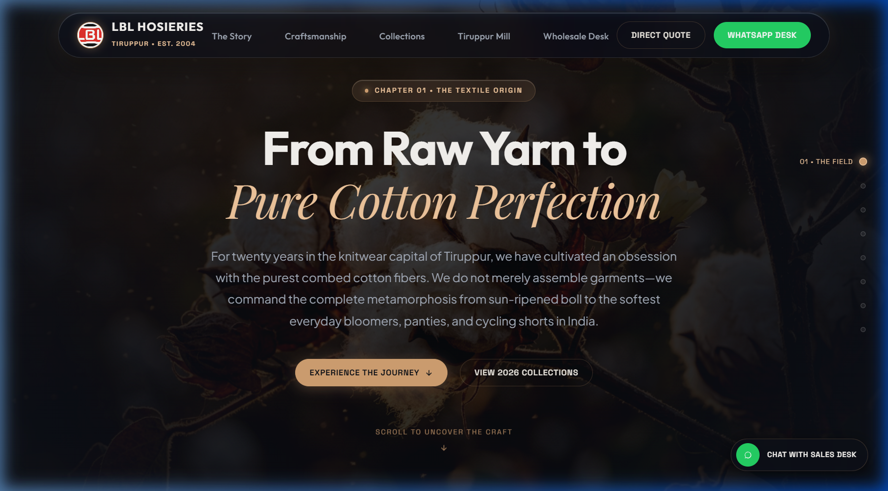
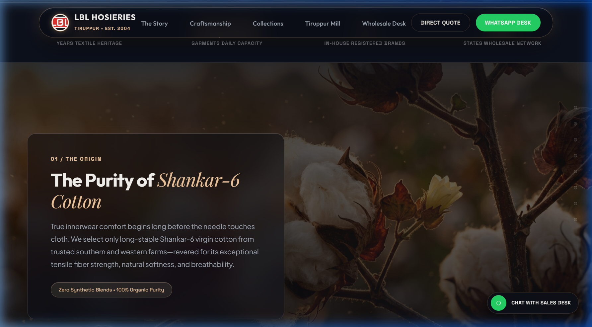
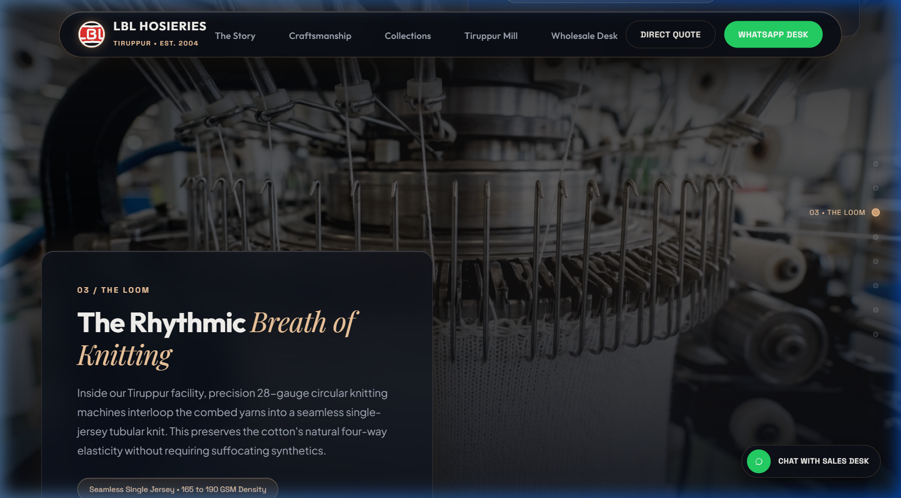
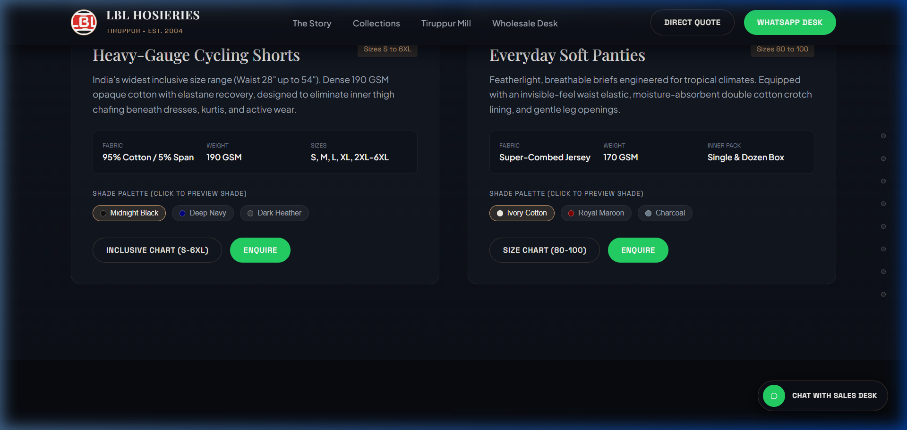
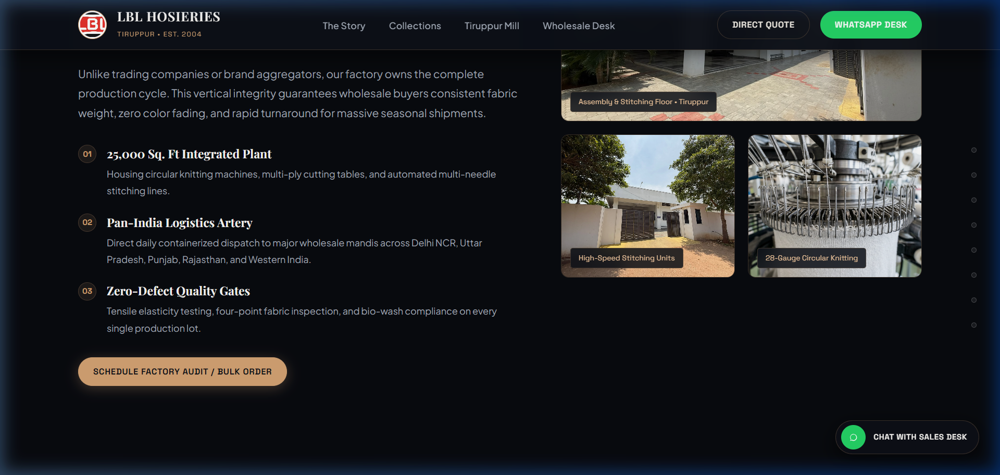

# LBL Hosieries — Website Screenshots & Visual Showcase

Visual gallery demonstrating the **Scrollytelling Editorial Web Experience** for **LBL Hosieries (Tiruppur, Tamil Nadu)**.

---

### 1. Hero Section & Floating Glassmorphic Top Bar Island
*Featuring the floating centered pill navigation with frosted glassmorphism, glowing monogram badge, and high-impact Outfit typography.*

---

### 2. Pinned Scrollytelling & Frosted Glass Narrative Cards
*The sticky 100vh visual canvas crossfading through textile stages with multi-layer glassmorphic narrative cards and amber accents.*

---

### 3. Editorial Collections Lookbook
*High-fashion studio flatlays and editorial photography for Kids Bloomers (45-75), Ladies Bloomers (75-100), Cycling Shorts (S-6XL), and Everyday Panties with tactile shade pickers.*

---

### 4. Interactive Inclusive Size Chart Modal
*Detailed textile sizing table with age, waist (inches/cm), and carton packaging specifications.*

---

### 5. Wholesale Procurement Desk & Live Dispatch Estimator
*B2B order estimator calculating master cartons, gross shipping weight, and express transit days to North Indian & pan-India wholesale mandis.*

